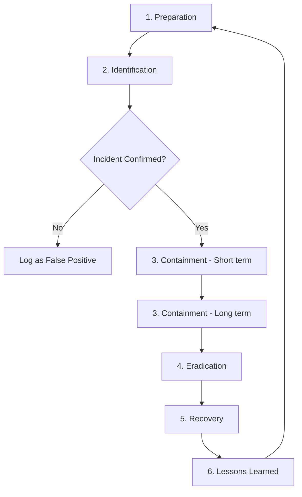

# Incident Response Playbook: Phishing-Led Credential Compromise

## Scenario
An employee clicks a phishing link, enters their credentials on a fake
login page, and the attacker gains access to their email/account.

## Tools Referenced
- SIEM tools (e.g., Splunk) - for log correlation and alerting
- Response automation / SOAR tools - for automated containment actions

## 1. Preparation
- Security awareness training conducted quarterly
- Email filtering/spam detection in place (SPF, DKIM, DMARC configured)
- Multi-Factor Authentication (MFA) enforced on all accounts
- Incident response team contacts documented and accessible 24/7
- Backup of critical systems maintained and tested
- SIEM configured with correlation rules for login + email events

## 2. Identification
- How the incident is detected:
  - User self-reports clicking a suspicious link
  - SIEM alert for login from unusual location/IP
  - Unusual email-forwarding rule created in victim's mailbox
  - Multiple failed MFA prompts (push bombing)
- Indicators of Compromise (IOCs) to check:
  - Sender email address, phishing URL, email headers
  - Login logs for the affected account
  - Any new inbox rules or OAuth app grants

### SIEM Correlation Example (Splunk-style)

In a real environment, a SIEM tool like Splunk would correlate login and
email logs to surface this incident automatically during Identification.

**Sample SIEM Alert**

Alert: Suspicious Login Following Phishing Click
Severity: High
Timestamp: 2026-10-18 09:42:13
User: john.doe@company.com
Source IP: 185.220.101.47 (Geo: Unknown VPN exit node)
Event: Successful login 3 minutes after user clicked a flagged
       phishing URL (logged by email gateway)
MFA Status: Bypassed - session token reused
Correlated Events:
  - 09:39:02  Email gateway flagged link as phishing (not blocked)
  - 09:39:45  User clicked link (proxy log)
  - 09:42:13  Login from unrecognized IP, same session token
  - 09:43:01  New inbox forwarding rule created

**Sample Splunk Search Query**

index=email_logs sourcetype=proxy "phishing_flagged=true"
| join session_id [search index=auth_logs sourcetype=login_events]
| where login_time > click_time AND login_time < click_time + 300
| table user, src_ip, click_time, login_time, mfa_status

**What this query does:** searches email/proxy logs for flagged phishing
link clicks, joins them with login logs by session ID, and filters for
any login within 5 minutes of the click - a strong indicator the
credentials were just stolen and used.

**Note:** Due to time constraints, SIEM correlation is illustrated here
with sample alert data rather than a live Splunk instance.

## 3. Containment
### Short-term
- Immediately disable/suspend the compromised account
- Force a password reset
- Revoke active sessions/tokens for that account
### Long-term
- Block the phishing domain/IP at the email gateway and firewall
- Add the phishing sender to blocklist

## Response Automation Note

Several containment steps above (disabling the account, revoking
sessions, blocking the sender domain) could be automated using a SOAR
(Security Orchestration, Automation, and Response) tool such as Splunk
SOAR, Microsoft Sentinel Playbooks, or Palo Alto Cortex XSOAR. An
automated playbook would trigger these containment actions immediately
when the SIEM alert fires, reducing response time from minutes to
seconds.

## 4. Eradication
- Remove any malicious inbox rules or forwarding set up by the attacker
- Revoke any suspicious third-party app access (OAuth grants)
- Scan the user's device for malware if a payload was also delivered
- Identify and patch the detection gap that let the email through

## 5. Recovery
- Restore the account with a new, strong password + MFA re-enrollment
- Monitor the account closely for 7-14 days for repeat suspicious activity
- Notify the user and confirm normal access

## 6. Lessons Learned
- Was the phishing email a known pattern? Could the email filter be tuned?
- Did the user report it quickly, or was there a detection delay?
- Update security awareness training with this specific phishing example
- Update this playbook if any step was unclear or missing during the drill
- Review whether the SIEM correlation rule fired correctly

## Incident Response Flow

