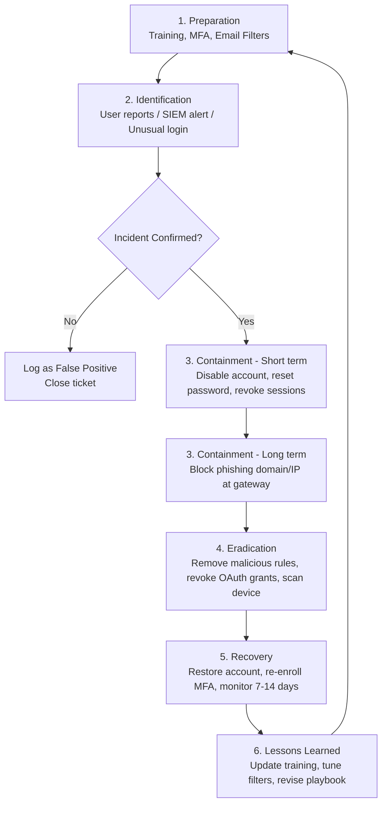

# Incident Response Playbook: Phishing-Led Credential Compromise

## Scenario
An employee clicks a phishing link, enters their credentials on a fake
login page, and the attacker gains access to their email/account.

## 1. Preparation
- Security awareness training conducted quarterly
- Email filtering/spam detection in place (SPF, DKIM, DMARC configured)
- Multi-Factor Authentication (MFA) enforced on all accounts
- Incident response team contacts documented and accessible 24/7
- Backup of critical systems maintained and tested

## 2. Identification
- How the incident is detected:
  - User self-reports clicking a suspicious link
  - SIEM alert for login from unusual location/IP
  - Unusual email-forwarding rule created in victim's mailbox
  - Multiple failed MFA prompts (push bombing)
- Indicators of Compromise (IOCs) to check:
  - Sender email address, phishing URL, email headers
  - Login logs for the affected account
  - Any new inbox rules or OAuth app grants

## 3. Containment
### Short-term
- Immediately disable/suspend the compromised account
- Force a password reset
- Revoke active sessions/tokens for that account
### Long-term
- Block the phishing domain/IP at the email gateway and firewall
- Add the phishing sender to blocklist

## 4. Eradication
- Remove any malicious inbox rules or forwarding set up by the attacker
- Revoke any suspicious third-party app access (OAuth grants)
- Scan the user's device for malware if a payload was also delivered
- Identify and patch the detection gap that let the email through

## 5. Recovery
- Restore the account with a new, strong password + MFA re-enrollment
- Monitor the account closely for 7-14 days for repeat suspicious activity
- Notify the user and confirm normal access

## 6. Lessons Learned
- Was the phishing email a known pattern? Could the email filter be tuned?
- Did the user report it quickly, or was there a detection delay?
- Update security awareness training with this specific phishing example
- Update this playbook if any step was unclear or missing during the drill

## Incident Response Flow

